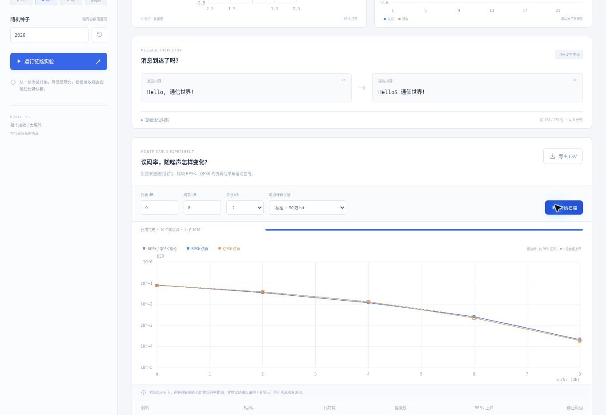

# CommScope Lab · 数字通信实验台

一条可观察、可复现的数字通信链路：文字或随机比特经过 BPSK / Gray QPSK 调制、AWGN 信道和相干判决，显示接收星座、错误位置与误码率。

[](https://github.com/Mecony/commscope-lab/actions/workflows/ci.yml)

**v0.1.0 · 符号级、理想同步、无编码的复基带模型**




## 功能

- 中文、英文、emoji 的 UTF-8 编码与恢复；随机比特模式。
- BPSK、Gray QPSK，统一单位符号能量，按 Eᵦ/N₀ 正确生成噪声。
- 无噪声对照；固定随机种子；参数改变后提示结果待更新。
- I/Q 星座、I 支路离散符号、逐位错误标记和文字恢复。
- Web Worker 蒙特卡洛扫描，进度、取消、每点错误数/比特数、停止条件。
- 对数 BER 图、理论曲线、近似区间；零错误显示单侧上界。
- CSV 结果与 JSON 实验参数导出。
- 独立 NumPy/SciPy 参考程序、理论数值基准和自动测试。

计算在浏览器本机完成，无服务器 API、外部 CDN、账号或硬件依赖。Python 参考程序用于独立验证，不是网页运行的必要条件。

## 运行

可靠方式：使用 Python 3 启动 HTTP 静态服务器。

```bash
python3 -m http.server 8000 --directory dist
```

打开 `http://localhost:8000`。Windows 可用 `py -m http.server 8000 --directory dist`。

根目录的 **CommScope-Lab.html** 是本地体验版：CSS 与脚本全部内嵌；扫描使用可取消的分块计算，不依赖 Worker、模块加载、网络请求或服务器。下载到电脑后，可用 Chrome 或 Edge 打开，不需要登录 ChatGPT 或安装 Python。

请先下载文件并从电脑的下载文件夹打开，不要将 ChatGPT 或 GitHub 的文件预览当成程序运行。当前环境不允许浏览器访问 `file://`，实际双击兼容性仍未实测；该版本已通过脚本语法、无外部启动依赖、计算一致性和取消操作测试。

重新生成单文件版：

```bash
python3 scripts/build-portable.py
```

## 试三个实验

1. **完整恢复：** 发送 `Hello, 通信世界！`，选择无噪声并运行，检查 TX/RX 相同、错误数为零。
2. **噪声影响：** 选择 QPSK、4 dB、种子 2026 运行，观察星座偏移和错误标记。切换 0 dB 后重新运行，比较结果。
3. **理论验证：** 默认扫描 0～8 dB，步长 2 dB，每点最多 50 万 bit，绘制 BPSK / QPSK 曲线并导出 CSV。高信噪比下达到样本上限是正常停止条件。

单条文字很短，其误码率波动可能很大。比较性能时使用批量扫描，不依据某一条短消息判断调制优劣。

## 测试与复现

JavaScript 无 npm 依赖，使用 Node.js 22 或更新版本：

```bash
npm run check
npm test
node scripts/run-experiments.mjs
```

Python 参考程序：

```bash
python3 -m pip install -r reference/requirements.txt
python3 -m unittest discover -s reference -p 'test_*.py' -v
python3 reference/simulate.py --ebn0 0 2 4 6 8 --seed 2026 --max-bits 500000 --output reference-results.csv
```

JavaScript 与 Python 采用不同的随机数发生器，同种子不保证逐比特相同；比较基于同一物理模型、理论值和统计容差。JavaScript 内部同种子、同配置可复现错误位置与扫描结果。

示例原始结果：[CSV](docs/example-results.csv)、[JSON](docs/example-results.json)。详见[模型说明](docs/MODEL.md)与[验证记录](docs/VALIDATION.md)。

## 核心模型

设每符号能量 Eₛ=1，每符号比特数 k=1（BPSK）或 2（QPSK），γᵦ=10^(Eᵦ/N₀[dB]/10)。每个实噪声分量的方差为：

`σ² = 1 / (2kγᵦ)`

两种调制在此模型下的理论比特误码率相同：

`Pᵦ = 0.5 × erfc(√γᵦ)`

参考：[MathWorks 理论表达式](https://www.mathworks.com/help/comm/ug/analytical-expressions-used-in-berawgn-function-and-bit-error-rate-analysis-app.html)、[能量关系](https://www.mathworks.com/help/comm/ug/mathematical-expressions-and-notations-used-in-ber-analysis.html)、[SciPy erfc](https://docs.scipy.org/doc/scipy/reference/generated/scipy.special.erfc.html)。网页计算不依赖 MATLAB。

## 工程结构

| 文件 | 作用 |
|---|---|
| `dist/core.js` | 编码、映射、噪声、判决、理论、区间、扫描计算 |
| `dist/worker.js` | 分块蒙特卡洛扫描和进度消息 |
| `dist/charts.js` | 星座、离散序列和 BER 图 |
| `dist/app.js` | 参数、状态、交互和结果导出 |
| `reference/` | NumPy/SciPy 独立参考与测试 |
| `tests/` | JavaScript 测试及 SciPy 数值基准 |
| `scripts/` | 单文件打包和命令行实验复现 |
| `.github/workflows/ci.yml` | JavaScript、便携版一致性与 Python 自动验证 |

## 边界与后续

- 第一版假设接收端相位、定时已知；不包含脉冲成形、匹配滤波、频偏恢复、纠错编码或射频硬件。
- I 支路图表示离散符号，横轴为符号索引，不是模拟载波波形。
- 扫描每点累计至至少 200 个错误（按块检查）或达到比特上限停止。Wilson 区间是描述性近似；依赖错误数的停止规则没有严格的序贯覆盖保证。
- 零错误上界在固定 N 的二项模型中是精确单侧 95% 上界，不能解释为误码率等于零。
- 未进行手机真机、多浏览器及 200 万比特上限的浏览器性能验收。

下一阶段可加入根升余弦脉冲成形、匹配滤波、眼图，再验证滤波延迟及符号采样。候选功能尚未实现。

代码采用 [MIT License](LICENSE)。
